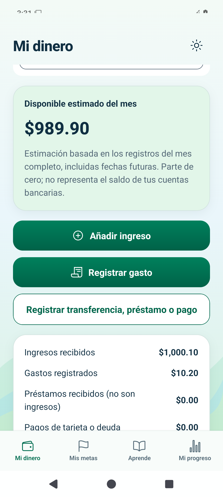
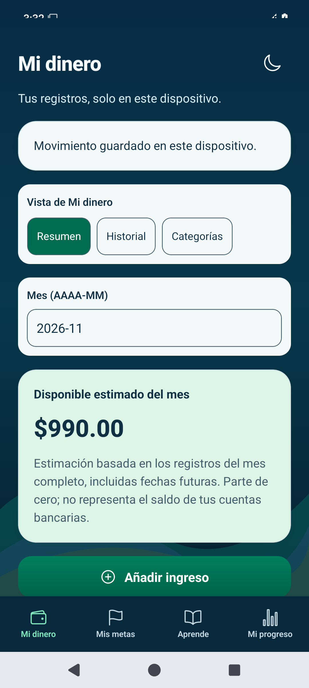
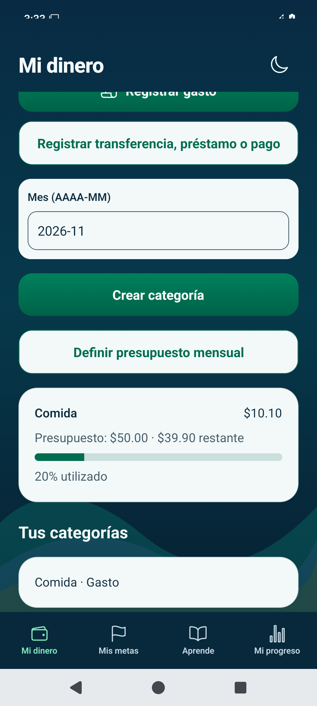
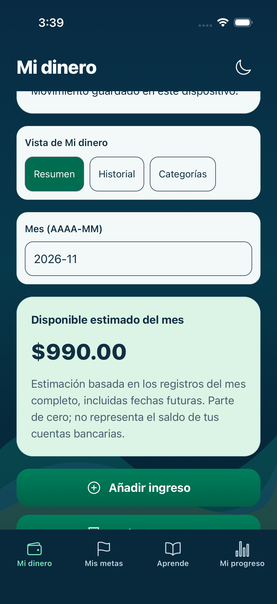

# EduMoney — Mi dinero y presupuesto

Capturas de la app nativa durante pruebas con **datos ficticios**. Son imágenes para revisar; no una aplicación interactiva.
Los importes se introdujeron en un emulador desechable y no pertenecen a una persona.

## 1. Registrar ingresos y gastos

Se registró un ingreso de **$1,000.10** y un gasto de **$10.20**. Disponible estimado: **$989.90**.

[**Abrir resumen en tema claro**](android-money-light.png)

## 2. Corregir un movimiento

El gasto se corrigió a **$10.10**, con motivo registrado. El disponible pasó a **$990.00**.
La diferencia entre estas capturas corresponde a esa corrección, no al cambio de tema.

[**Abrir resumen corregido en tema oscuro**](android-money-corrected.png) · [Ver historial](android-history-corrected.png)

## 3. Comparar con el presupuesto

Se asignó **$50.00** a Comida. Con **$10.10** gastados quedaron **$39.90**.
La captura siguiente se obtuvo después de cerrar y volver a abrir la app.

[**Abrir presupuesto tras reiniciar**](android-budget-reopened.png)

## 4. Comprobación en iPhone

El mismo registro y la corrección se probaron en el simulador de iPhone. Disponible estimado final: **$990.00**.

[Resumen claro](ios-money-light.png) · [Resumen oscuro](ios-money-dark.png) · [Historial corregido](ios-history-corrected.png)

Las pruebas automatizadas de [Android e iOS aprobaron](https://github.com/dieliza/edumoney/actions/runs/42494250916).
También se comprobó en iOS que el archivo permaneciera cifrado y sin cambios al reabrirlo.
Estas capturas no sustituyen las pruebas pendientes en dispositivos físicos.

[Guía de uso](../../../USAR_MI_DINERO.md) · [Arquitectura, archivos y pruebas](../../03.md)
