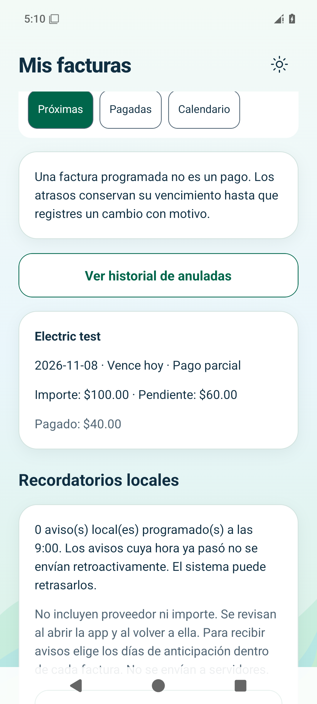
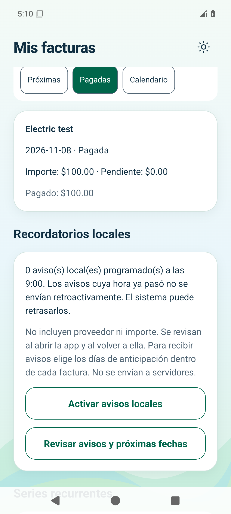
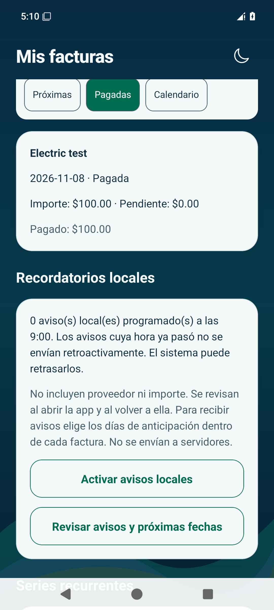

# EduMoney — Facturas en Android

Capturas de la versión final de Etapa 4 con **datos ficticios** en un emulador desechable. Son imágenes, no una aplicación interactiva.
La comprobación complementaria de iOS continúa en curso.

## Pago parcial

Factura de $100.00, primer pago de $40.00 y $60.00 pendientes.

## Pagada en ambos temas

Después del segundo pago de $60.00, el total pagado es $100.00 y el pendiente es cero.

| Claro | Oscuro |
| --- | --- |
|  |  |

[Calendario](android-calendar-dark.png) · [Factura conservada tras reiniciar](android-paid-reopened.png)

## Avisos locales

Otra factura de prueba, de $25.00, tiene un vencimiento futuro. Se comprobó un aviso programado, su presencia al reabrir y cero avisos después de pagarla.

[Un aviso programado](android-local-reminder.png) · [Tras reabrir](android-reminder-reopened.png) · [Cancelado después de pagar](android-reminder-cancelled-after-payment.png)

[Prueba Android aprobada](https://github.com/dieliza/edumoney/actions/runs/42502133336/job/128797073256) · [Guía de uso](../../../USAR_MIS_FACTURAS.md)
