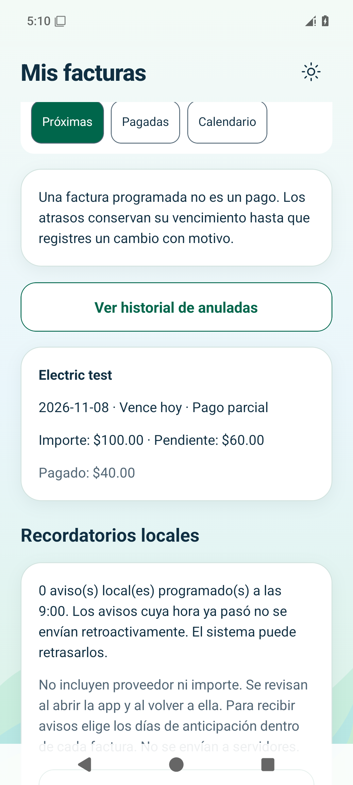
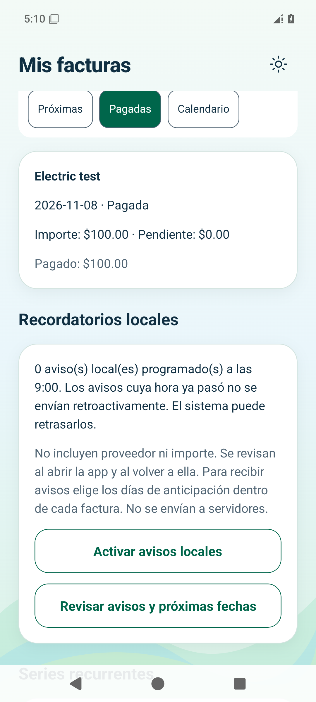
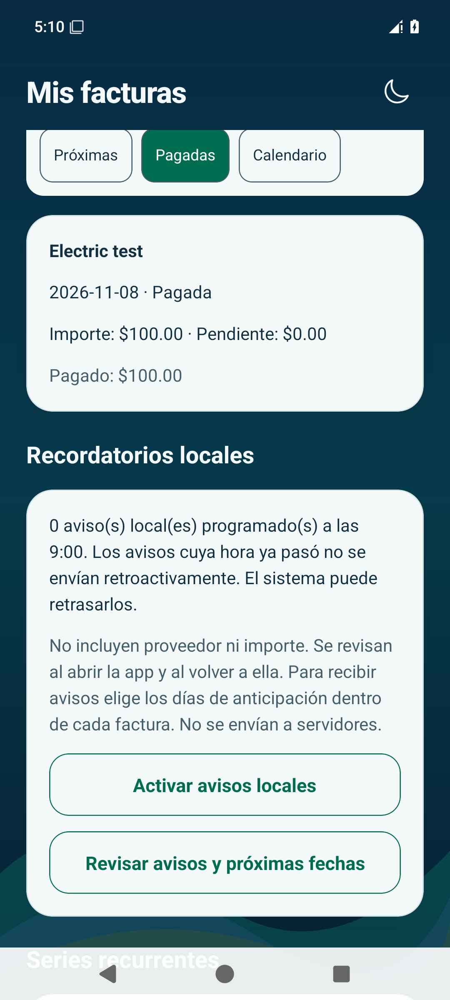

# EduMoney — Mis facturas

Capturas de la aplicación nativa con **datos ficticios**, obtenidas durante pruebas automatizadas en simuladores. Son imágenes para revisar, no una aplicación interactiva.

## 1. Factura y pago parcial

La factura de prueba es de **$100.00**. Un primer pago de **$40.00** deja **$60.00 pendientes**.
El segundo pago de **$60.00** completa la factura. Se conservan dos movimientos vinculados, por un total de **$100.00**.

[Factura pendiente](android-upcoming-light.png) · [Pago parcial en Android](android-partial.png) · [Pago parcial en iPhone](ios-partial.png)

## 2. Pagadas en los dos temas

El cambio de tema conserva los mismos importes y estados.

| Claro | Oscuro |
| --- | --- |
|  |  |

[iPhone claro](ios-paid-light.png) · [iPhone oscuro](ios-paid-dark.png)

## 3. Calendario y reapertura

La agenda mensual conserva la fecha de vencimiento y muestra si la factura está pagada.

[Calendario Android](android-calendar-dark.png) · [Calendario iPhone](ios-calendar-dark.png)

La factura pagada se conserva al cerrar y volver a abrir la aplicación:
[Android después de reiniciar](android-paid-reopened.png) · [iPhone después de reiniciar](ios-paid-reopened.png).

El total de gastos por los dos pagos de esta primera factura es **$100.00**, sin duplicar la factura completa:
[Mi dinero en Android](android-money-after-payments.png) · [Mi dinero en iPhone](ios-money-after-payments.png).

## 4. Avisos locales

Otra factura ficticia de **$25.00**, con un vencimiento futuro, permite comprobar la programación de un aviso local y su cancelación al confirmar el pago.
Estos $25.00 corresponden a otra factura; no son un cambio de tema ni una modificación de la primera.

| Comprobación | Android | iPhone |
| --- | --- | --- |
| Un aviso programado | [Abrir captura](android-local-reminder.png) | [Abrir captura](ios-local-reminder.png) |
| Aviso tras reabrir | [Abrir captura](android-reminder-reopened.png) | [Abrir captura](ios-reminder-reopened.png) |
| Cero avisos después de pagar | [Abrir captura](android-reminder-cancelled-after-payment.png) | [Abrir captura](ios-reminder-cancelled-after-payment.png) |

El dispositivo recibe solo un texto genérico, sin proveedor ni importe. La recepción en teléfonos físicos bajo restricciones de batería se comprobará en la validación general.

[Pruebas nativas de Android e iOS aprobadas](https://github.com/dieliza/edumoney/actions/runs/42502133336).

[Guía para usar Mis facturas](../../../USAR_MIS_FACTURAS.md) · [Arquitectura, archivos y pruebas](../../04.md)
