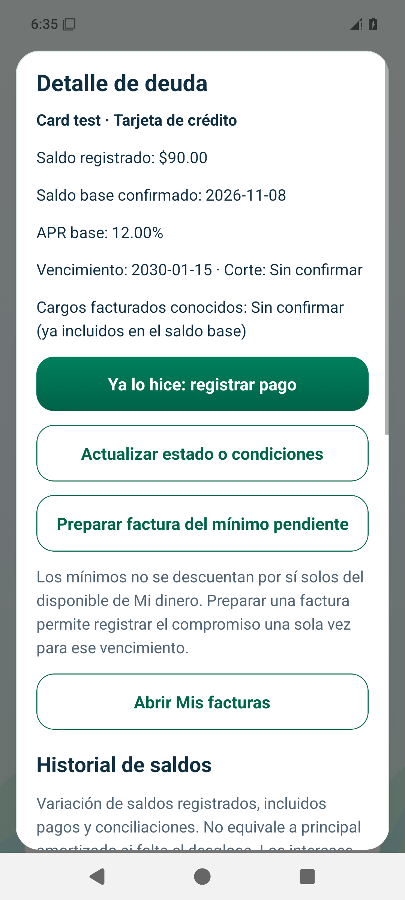
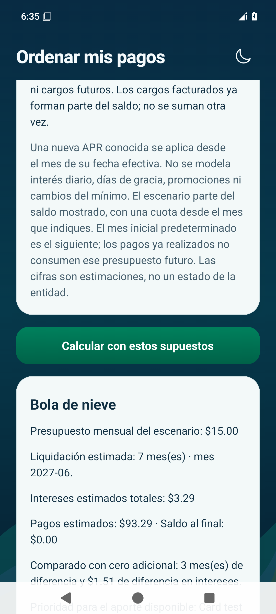

# EduMoney — Deudas y Ordenar mis pagos

Capturas nativas obtenidas con **datos ficticios** en simuladores desechables. Son imágenes para revisar, no una aplicación interactiva.

## 1. Deuda registrada

Se introdujo una tarjeta de prueba con saldo de **$100.00**, APR base de **12.00%** y mínimo de **$10.00**. El vencimiento futuro se eligió expresamente como dato ficticio.
Los datos desconocidos, como corte y cargos, siguen sin confirmar.

[Deuda en Android](android-debt-light.png) · [Deuda en iPhone](ios-debt-light.png)

## 2. Un pago para deuda y factura

Se preparó una factura por el mínimo de **$10.00** y se confirmó un pago de **$10.00** que aún reducía el saldo.
El saldo registrado quedó en **$90.00**; la factura del mínimo quedó atendida con **el mismo movimiento**, sin otro gasto por la compra.

[Saldo en iPhone](ios-payment-balance.png) · [Movimiento único en Mi dinero — Android](android-money-single-payment.png) · [Mi dinero — iPhone](ios-money-single-payment.png)

## 3. Comparar con un aporte adicional

El escenario parte de los **$90.00 pendientes**, con mínimo mensual de **$10.00** y aporte extra de **$5.00**: presupuesto mensual de **$15.00**.
Bajo APR/12, mínimos fijos y sin compras ni cargos nuevos, la estimación es **7 meses**, **$3.29** de intereses y **$93.29** en pagos futuros.
Ese total futuro no incluye el pago de $10.00 ya registrado.

Como este ejemplo tiene una sola deuda, bola de nieve y avalancha coinciden. Las pruebas independientes también comparan varias deudas con tasas y saldos distintos.

| Alternativa | Android | iPhone |
| --- | --- | --- |
| Bola de nieve | [Abrir resultado](android-snowball-dark.png) | [Abrir resultado](ios-snowball-dark.png) |
| Avalancha | [Abrir resultado](android-avalanche-dark.png) | [Abrir resultado](ios-avalanche-dark.png) |

Las cifras son estimaciones bajo los supuestos mostrados; no modifican saldos ni representan resultados garantizados por la entidad.

## 4. Calendario y plan de 30 días

El mínimo de ese vencimiento queda atendido, aunque todavía exista saldo de deuda pendiente.

[Calendario Android](android-calendar-dark.png) · [Calendario iPhone](ios-calendar-dark.png)

Se creó un plan y se confirmó una revisión: **1 de 6 tareas**. Marcar una tarea no registra un pago ni reduce deuda.

[Plan Android](android-plan-dark.png) · [Plan iPhone](ios-plan-dark.png)

## 5. Reapertura y temas

El saldo de $90.00 se conservó al cerrar y reabrir la aplicación, junto con el tema oscuro elegido.

[Android después de reabrir](android-debt-reopened-dark.png) · [iPhone después de reabrir](ios-debt-reopened-dark.png)

[Guía de uso](../../../USAR_ORDENAR_MIS_PAGOS.md) · [Arquitectura, archivos, cálculos y pruebas](../../05.md)

[Pruebas nativas aprobadas — Android e iOS](https://github.com/dieliza/edumoney/actions/runs/42509248655). También aprobaron 75 pruebas de lógica/SQLite, TypeScript, ESLint y tres pruebas de navegador. Las pruebas físicas y de accesibilidad con lectores siguen pendientes de la validación general.
