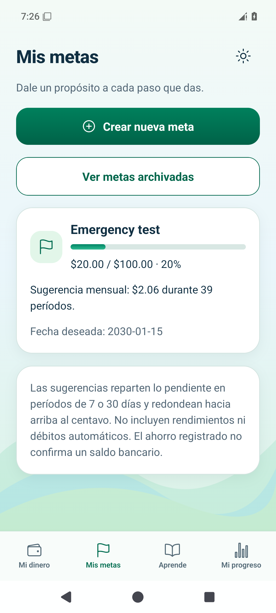
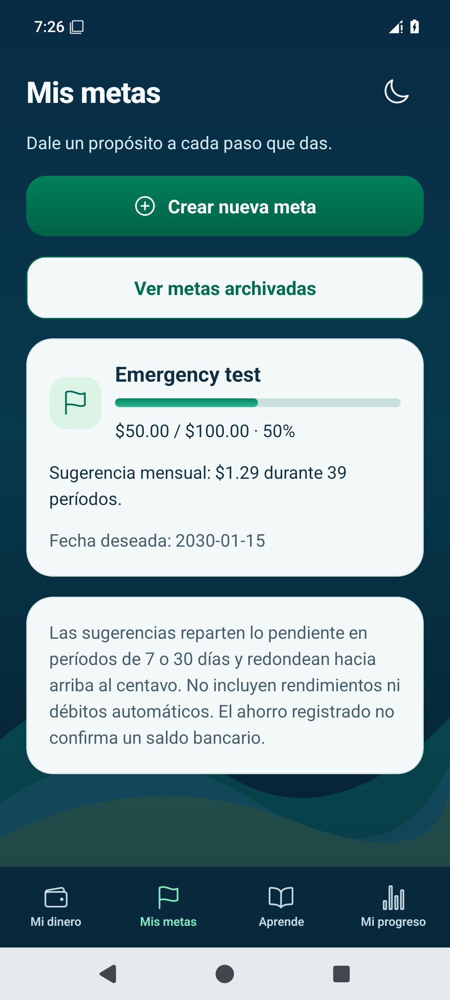

# Etapa 6 — Android

Datos ficticios de prueba. Android aprobó el recorrido sin conexión. iOS también aprobó. [Abrir la galería completa](README.md).

Meta de $100.00 con $20.00 previos y aportación única de $30.00: ahorro de $50.00. Al corregir el objetivo a $40.00 conserva $50.00 y muestra 125%, con barra al 100%. El plan guarda 1 de 8 revisiones; no genera otro movimiento.

[Objetivo corregido](android-goal-complete-dark.png) · [Progreso oscuro](android-progress-dark.png) · [Progreso claro](android-progress-light.png) · [Plan](android-plan-dark.png)

[Un movimiento en Mi dinero](android-money-single-contribution.png) · [Meta al reabrir](android-goal-reopened-dark.png) · [Plan al reabrir](android-plan-reopened-dark.png)

[Guía de uso](../../../USAR_MIS_METAS_Y_PROGRESO.md) · [Informe técnico](../../06.md) · [Ejecución de pruebas](https://github.com/dieliza/edumoney/actions/runs/42513869947/job/128832514063)
