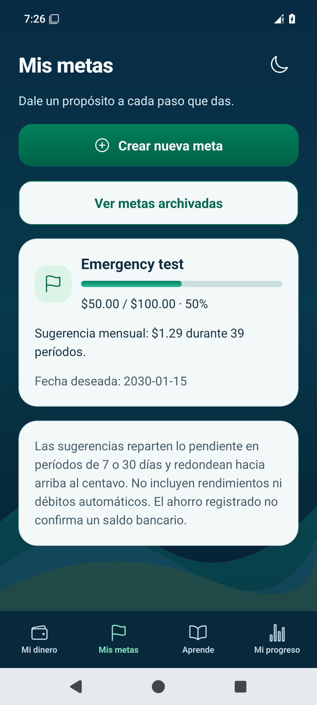

# EduMoney — Mis metas y Mi progreso

Capturas nativas con **datos ficticios de prueba**. Son imágenes para revisar, no una aplicación interactiva.

## Metas en ambos temas

El formulario empieza vacío. La meta de prueba tiene objetivo de **$100.00**, ahorro previo de **$20.00** y una fecha deseada futura elegida expresamente para la prueba.
Una aportación de **$30.00** aumenta el ahorro registrado a **$50.00 (50%)**. La base previa no genera un ingreso; la nueva aportación crea un solo movimiento de reserva.

| Vista | Android | iPhone |
| --- | --- | --- |
| Estado vacío | [Abrir](android-empty-light.png) | [Abrir](ios-empty-light.png) |
| Meta con ahorro previo, tema claro | [Abrir](android-goal-light.png) | [Abrir](ios-goal-light.png) |
| Meta con aportación, tema oscuro | [Abrir](android-goal-dark.png) | [Abrir](ios-goal-dark.png) |

## Cambiar el objetivo conserva el ahorro

Se corrigió el objetivo a **$40.00**, con motivo. Los **$50.00** ahorrados y la aportación se conservaron: **125%** del nuevo objetivo, barra limitada a 100% y reconocimiento de meta alcanzada. No se creó otro movimiento.

[Android](android-goal-complete-dark.png) · [iPhone](ios-goal-complete-dark.png)

## Progreso desde registros reales

Mi progreso muestra una meta alcanzada y un movimiento registrado. La falta de presupuesto y de facturas se informa con sus estados correspondientes; no se sustituyen por ejemplos.
El plan de 90 días conserva **1 de 8 revisiones confirmadas**. Confirmar una revisión no crea un pago ni una aportación.

| Vista | Android | iPhone |
| --- | --- | --- |
| Progreso oscuro | [Abrir](android-progress-dark.png) | [Abrir](ios-progress-dark.png) |
| Progreso claro | [Abrir](android-progress-light.png) | [Abrir](ios-progress-light.png) |
| Plan de 90 días | [Abrir](android-plan-dark.png) | [Abrir](ios-plan-dark.png) |

## Un movimiento y reapertura

Mi dinero muestra una única aportación de **$30.00**, separada de ingresos y gastos. Al reiniciar se conservaron **$50.00 de ahorro, objetivo de $40.00, tema oscuro y 1/8 revisiones**.

| Vista | Android | iPhone |
| --- | --- | --- |
| Aportación en Mi dinero | [Abrir](android-money-single-contribution.png) | [Abrir](ios-money-single-contribution.png) |
| Meta después de reabrir | [Abrir](android-goal-reopened-dark.png) | [Abrir](ios-goal-reopened-dark.png) |
| Plan después de reabrir | [Abrir](android-plan-reopened-dark.png) | [Abrir](ios-plan-reopened-dark.png) |

[Guía de uso](../../../USAR_MIS_METAS_Y_PROGRESO.md) · [Arquitectura, archivos, cálculos y pruebas](../../06.md)

Pruebas aprobadas: **94 de lógica/SQLite**, TypeScript, ESLint, **tres de navegador** y recorridos nativos en [Android](https://github.com/dieliza/edumoney/actions/runs/42513869947/job/128832514063) e [iOS](https://github.com/dieliza/edumoney/actions/runs/42516397755). Cifrado y reapertura comprobados en iOS; Android probado sin conexión. Las pruebas físicas y con lectores de pantalla siguen pendientes de la validación final.
