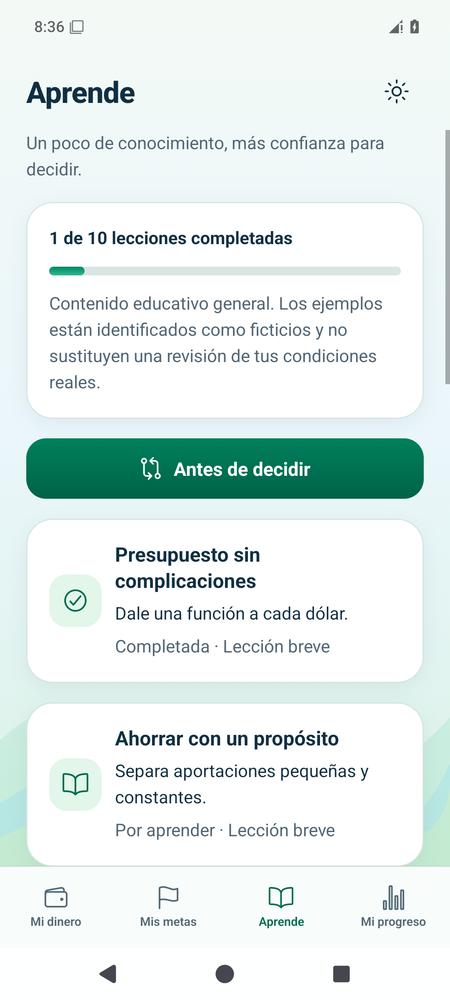
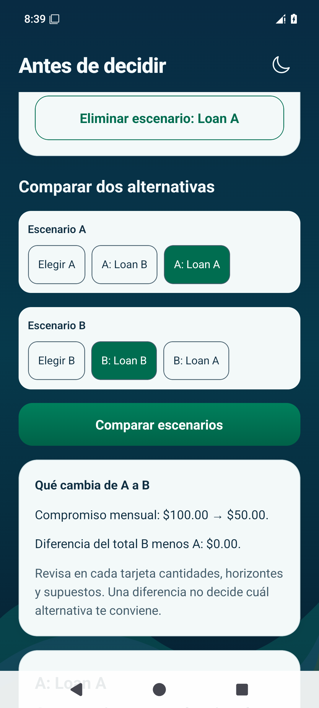

# Etapa 7 — Android

Datos ficticios de prueba. Android aprobó el recorrido sin Wi-Fi ni datos. iOS continúa en verificación.

Se resolvió la lección de presupuesto y se conservó **1 de 10 lecciones completadas**. Se guardaron dos préstamos ficticios de **$1,200 al 0%**: **12 meses/$100** y **24 meses/$50**, con total de $1,200 en ambos casos. El margen mensual elegido fue $500, sin cargos ni costos adicionales confirmados.

[Ejercicio](android-lesson-light.png) · [Capacidad de voz y alternativa textual](android-voice-capability.png)

[Préstamo claro](android-loan-light.png) · [Préstamo oscuro](android-loan-dark.png) · [Escenarios al reabrir](android-scenarios-reopened-dark.png) · [Avance al reabrir](android-learn-reopened-dark.png) · [Préstamo recuperado](android-loan-reopened-dark.png)

[Guía de uso](../../../USAR_APRENDE_Y_SIMULADORES.md) · [Informe técnico](../../07.md)
