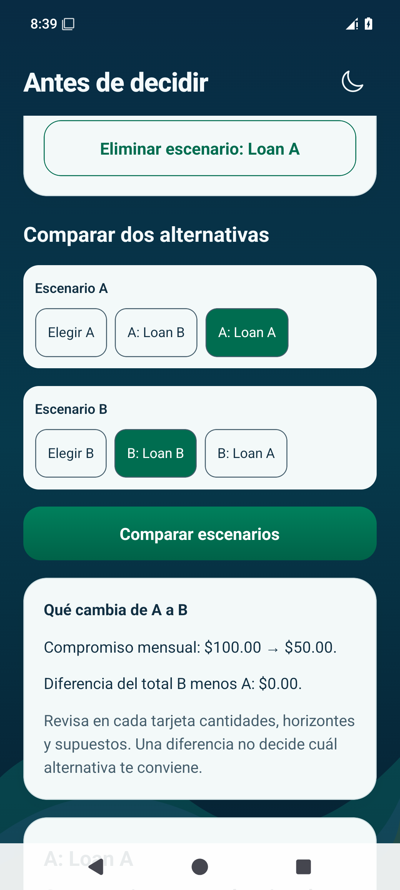

# EduMoney — Aprende y Antes de decidir

Capturas nativas con **datos ficticios de prueba**, para revisar visualmente. No son una aplicación interactiva ni ofertas de préstamo.

## Una lección y su ejercicio

Se abrió Presupuesto sin complicaciones y se resolvió el ejemplo de $1,000 menos $700: **$300 antes de otros compromisos**. El avance pasó a **1 de 10 lecciones completadas**.

| Vista | Android | iPhone |
| --- | --- | --- |
| Ejercicio resuelto | [Abrir](android-lesson-light.png) | [Abrir](ios-lesson-light.png) |
| Aprende, tema claro | [Abrir](android-learn-light.png) | [Abrir](ios-learn-light.png) |
| Capacidad de voz local | [Abrir](android-voice-capability.png) | [Abrir](ios-voice-capability.png) |

La lectura integrada solo se intenta con una voz española básica disponible en iOS. Si falta, se conserva el texto. En Android se informa que no puede comprobarse si el motor requiere red y se mantiene lectura textual/lector del dispositivo con voz descargada. Estas imágenes comprueban la respuesta de la interfaz; la audición física sigue pendiente de validación en dispositivos.

## Comparar dos plazos sin crear una deuda

Se eligieron datos ficticios explícitos: **principal $1,200, tasa nominal 0%, cargos financiados $0, cargos iniciales $0, adicionales mensuales $0 y margen mensual elegido $500**.

- **Loan A:** 12 meses → compromiso mensual **$100**, total **$1,200**, intereses **$0**, margen mensual restante **$400**.
- **Loan B:** 24 meses → compromiso mensual **$50**, total **$1,200**, intereses **$0**, margen mensual restante **$450**.

La comparación muestra lo que cambia bajo esos supuestos. No elige una alternativa, no consulta el banco ni registra una deuda o pago real.

| Vista | Android | iPhone |
| --- | --- | --- |
| Préstamo A, tema claro | [Abrir](android-loan-light.png) | [Abrir](ios-loan-light.png) |
| Préstamo B, tema oscuro | [Abrir](android-loan-dark.png) | [Abrir](ios-loan-dark.png) |
| Comparación A/B | [Abrir](android-comparison-dark.png) | [Abrir](ios-comparison-dark.png) |

Los otros simuladores son Vehículo, Vivienda, Gasto recurrente, Ahorro y Fondo de emergencia. Sus cálculos y datos faltantes también están cubiertos por las pruebas de lógica.

## Conservar el avance y los escenarios

Al cerrar y abrir se conservaron **1/10 lecciones, los dos escenarios y el tema oscuro**. Cargar Loan A recuperó sus inputs y la cuota de $100 sin sobrescribir el original.

| Vista | Android | iPhone |
| --- | --- | --- |
| Aprende después de reabrir | [Abrir](android-learn-reopened-dark.png) | [Abrir](ios-learn-reopened-dark.png) |
| Escenarios después de reabrir | [Abrir](android-scenarios-reopened-dark.png) | [Abrir](ios-scenarios-reopened-dark.png) |
| Loan A recuperado | [Abrir](android-loan-reopened-dark.png) | [Abrir](ios-loan-reopened-dark.png) |

[Guía de uso](../../../USAR_APRENDE_Y_SIMULADORES.md) · [Arquitectura, archivos, fórmulas y pruebas](../../07.md)

Verificación aprobada: **117 pruebas de lógica/SQLite**, TypeScript, ESLint, **tres pruebas de navegador** y [recorridos nativos en iOS y Android](https://github.com/dieliza/edumoney/actions/runs/42519676682). Se comprobó cifrado/reapertura en iOS y recorrido sin conexión en Android. Pruebas físicas de audio y accesibilidad siguen pendientes de la calidad final.
