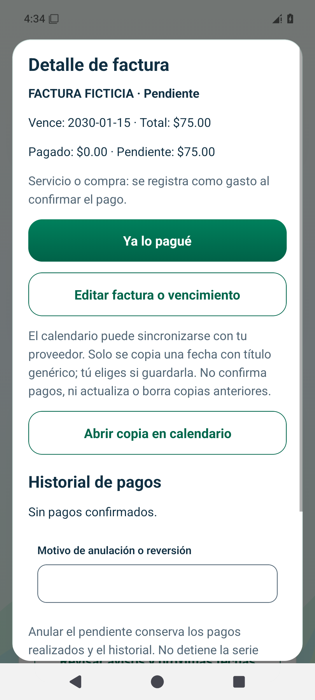

# EduMoney — Escaneo, voz y documentos

Imágenes obtenidas con **datos ficticios** en compilaciones de validación. Son capturas para revisar, no una aplicación interactiva ni comprobantes reales.

## Reconocimiento local y revisión

Una imagen sintética incluida muestra COMERCIO FICTICIO, fecha 2026-11-08, subtotal $50, IVU $5 y **TOTAL $55**. Se ejecuta el OCR nativo real; después se revisan sus propuestas y se elige expresamente gasto realizado, método y conservación de copia. El reconocimiento por sí solo no registra un pago.

[Revisión en Android](android-review-ocr.png) · [Revisión en iPhone](ios-review-ocr.png)

## Conservar y recuperar la copia cifrada

Se guardó una sola compra de **$55.00** y se eligió conservar copia local cifrada. El contenido se recuperó desde SQLCipher para mostrarlo y volvió a abrirse después de reiniciar.

| Vista | Android | iPhone |
| --- | --- | --- |
| Copia recién guardada | [Abrir](android-copy-first.png) | [Abrir](ios-copy-first.png) |
| Un gasto en Mi dinero | [Abrir](android-money-once.png) | [Abrir](ios-money-once.png) |
| Copia recuperada al reabrir | [Abrir](android-copy-reopened.png) | [Abrir](ios-copy-reopened.png) |

## Retirar la imagen y bloquear su duplicado

Con motivo confirmado se retiró **solo la copia**. El movimiento, los datos y la huella se conservaron. La misma imagen se intentó revisar de nuevo y se abrió el documento existente, sin insertar otro gasto ni restaurar automáticamente la copia eliminada.

| Vista | Android | iPhone |
| --- | --- | --- |
| Copia retirada | [Abrir](android-copy-removed.png) | [Abrir](ios-copy-removed.png) |
| Segunda revisión de la misma imagen | [Abrir](android-duplicate-review.png) | [Abrir](ios-duplicate-review.png) |
| Duplicado bloqueado | [Abrir](android-duplicate-blocked.png) | [Abrir](ios-duplicate-blocked.png) |

## Factura pendiente, no pagada

Se añadió por revisión manual una factura ficticia de **$75.00**, con vencimiento futuro elegido expresamente (2030-01-15). Mis facturas muestra **pagado $0.00 y pendiente $75.00**; no se creó otro gasto pagado.

[Documento Android](android-pending-document.png) · [Documento iPhone](ios-pending-document.png)

[Factura en iPhone](ios-pending-bill.png) · [Documentos oscuros Android](android-documents-dark.png) · [Documentos oscuros iPhone](ios-documents-dark.png)

## Alcance de estas pruebas

Se utiliza una imagen sintética local para probar los motores nativos, sin cámara física ni datos personales. Las pruebas de servicios cubren permisos denegados, cancelación, OCR fallido, limpieza y dictado local sin fallback remoto. La cámara y el audio físicos dependen del dispositivo y requieren validación de calidad; la entrada manual permanece disponible.

[Guía de uso](../../../USAR_ESCANEO_VOZ_Y_DOCUMENTOS.md) · [Arquitectura, archivos y pruebas](../../08.md)

## Resultados verificados

154 pruebas de lógica/SQLite y servicios, TypeScript, ESLint y 3 recorridos de navegador aprobados. Recorridos nativos completos aprobados: [Android sin conexión](https://github.com/dieliza/edumoney/actions/runs/42560531474) e [iOS](https://github.com/dieliza/edumoney/actions/runs/42566746264).

En iOS se verificaron cifrado, rechazo de SQLite sin clave, huella estable al reabrir y exclusión de backup, con la copia conservada y después de retirarla. [Resultados técnicos de cifrado](cipher-checks.json).
