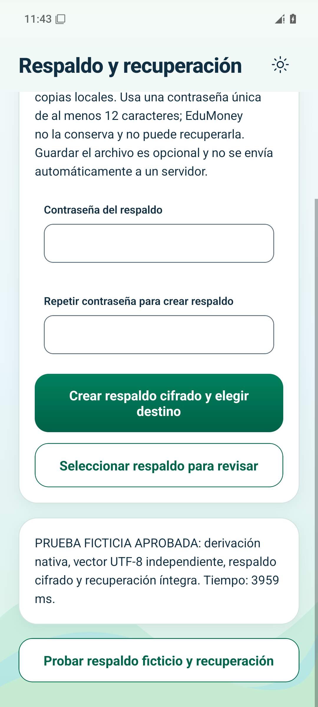
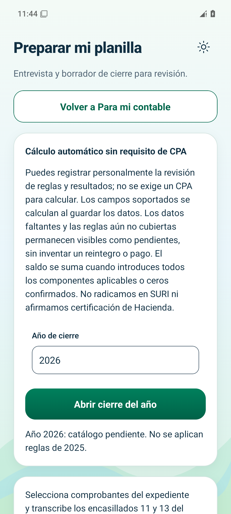
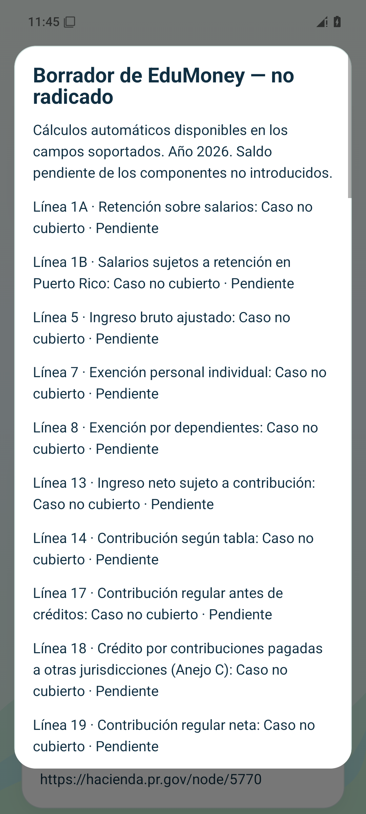
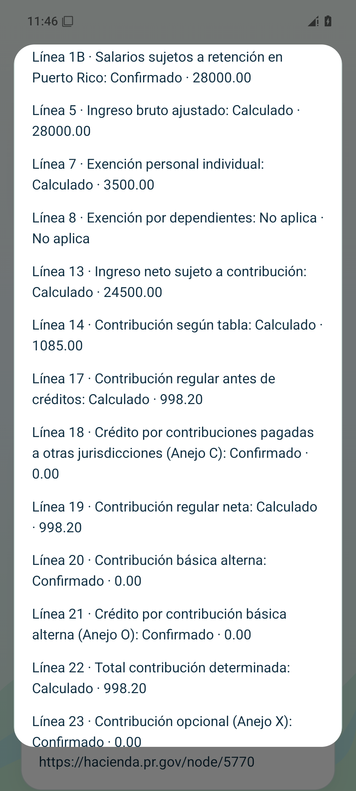
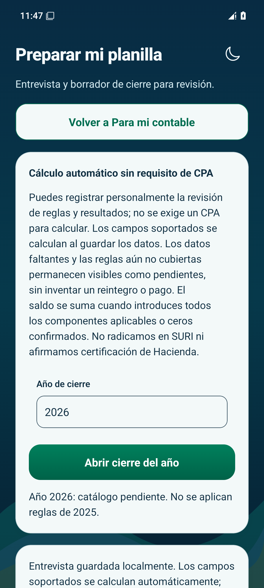
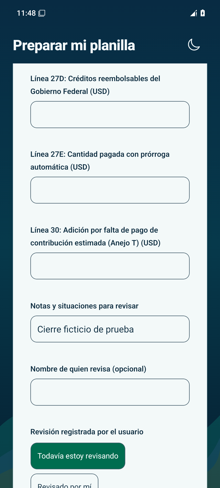

# EduMoney — revisión de etapa 10

[Ver el PDF ficticio de 2025](2025-ficticio-no-radicado.pdf) · [Informe de implementación y límites](../../10.md) · [Guía de uso](../../../USAR_CIERRE_Y_RESPALDO.md)

Estas capturas utilizan información ficticia. La aplicación calcula sin exigir revisión de un CPA. Los datos o reglas que faltan se muestran como pendientes; los campos vacíos no se convierten en cero. No hay radicación en SURI.

## Android

Recorrido aprobado el 9 de noviembre de 2026, ejecución [42608879499](https://github.com/dieliza/edumoney/actions/runs/42608879499), aplicación compilada desde `3e4ea0b`. Emulador Android API 35, sin Wi-Fi ni datos durante el recorrido.

| Respaldo recuperado | Año pendiente | Campos pendientes |
| --- | --- | --- |
|  |  |  |

| Caso ficticio de 2025 | Tema oscuro | Reapertura |
| --- | --- | --- |
|  |  |  |

La prueba contrasta un vector independiente de cifrado con contraseña UTF-8 y recupera íntegramente las tablas. El recorrido completo de respaldo en este emulador tardó 3,959 ms. El caso ficticio declara salario de $28,000, retención de $1,000 y cero explícito en los demás componentes: línea 17 de $998.20 y sobrepago de $1.80. La elegibilidad de esos componentes no se determina automáticamente.

Mediciones puntuales: [arranque de actividad](android-startup.txt), 1,051 ms; [memoria](android-memory.txt), PSS de 98,935 KB. No equivalen a tiempos garantizados ni mediciones de batería en teléfonos reales.

## iOS

La compilación de simulador está aprobada. Se repite el recorrido para localizar correctamente la confirmación del respaldo después de desplazarse. El resultado final todavía está pendiente.

## Antes de distribución

Estas compilaciones son para simuladores, no paquetes firmados para teléfonos. Siguen pendientes las pruebas físicas, destinos reales de compartir, revisión del mapa completo del formulario y redondeos oficiales. No se ha publicado la aplicación ni fusionado main. Negocio conserva su etapa separada antes de finalizar la aplicación.
