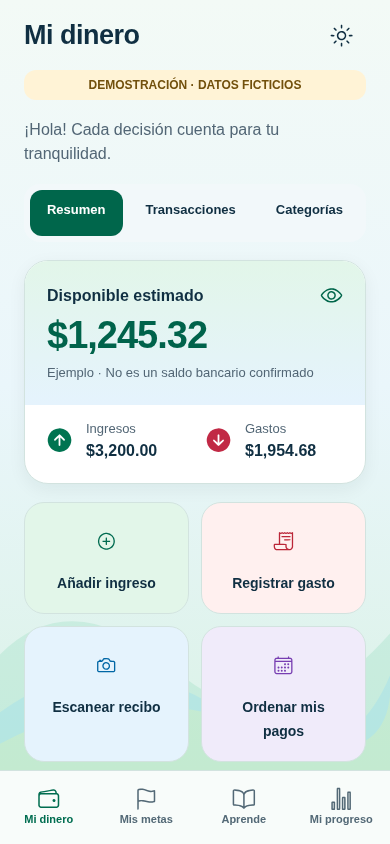
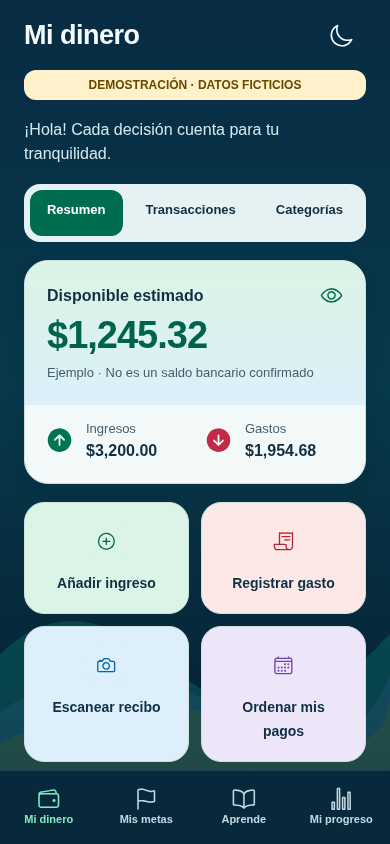

# Vistas de EduMoney — Etapa 2

Todas las cantidades son ficticias. Estas pantallas no registran movimientos financieros.
El nombre en texto se reemplazará por el logo oficial cuando esté disponible su archivo original.

## Tema claro

## Tema oscuro

## Navegación

| Sección | Claro | Oscuro |
| --- | --- | --- |
| Bienvenida | [Ver](02-light-welcome.png) | [Ver](02-dark-welcome.png) |
| Mis metas | [Ver](02-light-goals.png) | [Ver](02-dark-goals.png) |
| Aprende | [Ver](02-light-learn.png) | [Ver](02-dark-learn.png) |
| Mi progreso | [Ver](02-light-progress.png) | [Ver](02-dark-progress.png) |

[Selector Claro / Oscuro / Automático](02-theme-picker.png).

Las imágenes anteriores son vistas web de revisión. El [informe de pruebas](../02.md) distingue
los resultados de navegador de las comprobaciones nativas en iOS y Android.

## Capturas nativas Android

[Mi dinero claro](02-android-light-money.png) · [Mi dinero oscuro](02-android-dark-money.png) ·
[Automático claro](02-android-automatic-light.png) · [Automático oscuro](02-android-automatic-dark.png) ·
[Letra al 130 % en bienvenida](02-android-font130.png).

## Capturas nativas iOS

[Mi dinero claro](02-ios-light-money.png) · [Mi dinero oscuro](02-ios-dark-money.png) ·
[Mis metas claro](02-ios-light-goals.png) · [Mis metas oscuro](02-ios-dark-goals.png) ·
[Aprende claro](02-ios-light-learn.png) · [Aprende oscuro](02-ios-dark-learn.png) ·
[Mi progreso claro](02-ios-light-progress.png) · [Mi progreso oscuro](02-ios-dark-progress.png).
